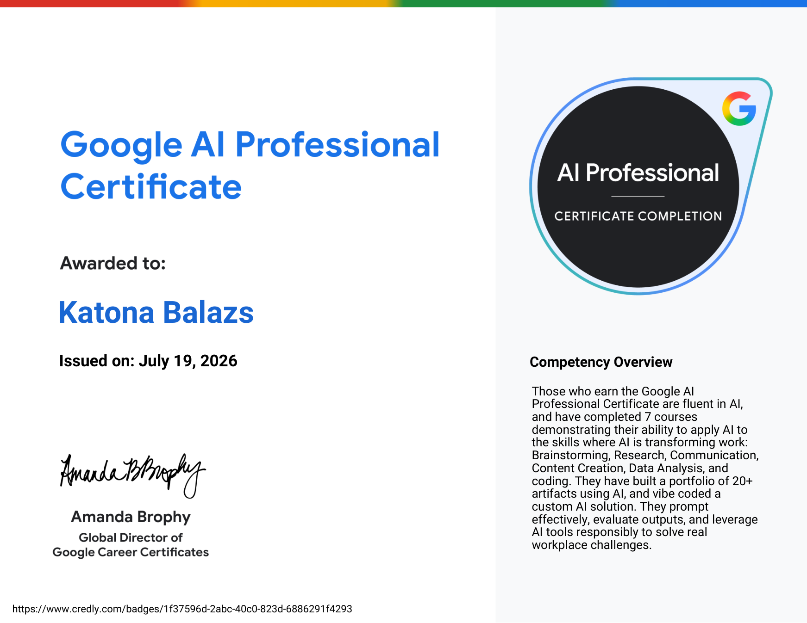

# 👋 Hi, I'm Balázs — aka Noxidus

**Penetration Tester** · Hungary 🇭🇺

Working both sides of the fence — **red team** offensive testing and **blue team** digital
forensics.

Breaking into systems and investigating how someone else did it are the same skill viewed from two
directions. Attacking teaches me what artifacts get left behind; forensics teaches me what an
attacker forgets to clean up. I document both, because explaining an engagement or an investigation
is where the actual learning happens.

---

## ⚔️ Red Team

- **Penetration testing** — web application and network assessments
- **Reconnaissance & enumeration** — subdomain and vhost discovery, service fingerprinting, content discovery
- **Exploitation** — credential attacks, misconfiguration abuse, privilege escalation
- **Post-exploitation** — persistence mechanisms, lateral movement, cloud API abuse
- **Tooling** — small Python utilities for scanning and credential analysis

## 🛡️ Blue Team

- **Digital forensics** — Linux authentication logs, `wtmp`/`utmp` session artifacts, timeline reconstruction
- **Network forensics** — PCAP analysis, attack-chain reconstruction, exfiltration tracking
- **Malware analysis** — static ELF triage: symbol recovery, disassembly, C2 extraction
- **Threat intelligence** — correlating vendor reporting into actor profiles and MITRE ATT&CK mappings

---

## 🛠️ Skills

**Offensive**

**Defensive & Forensics**

-2C3E50?style=for-the-badge)

**Languages**

**Web & Data**

**Tools & CI**

---

## 🧪 Security work

### [tracehound](https://github.com/Noxiidus/tracehound) · `Python` · `Blue Team` · **flagship**

A Linux DFIR triage toolkit, built from scratch.

**Twelve parsers** — seven log/event sources (`auth.log`, the utmp family, `lastlog`, shell
history, cron, systemd journal, and plaso super-timelines) plus five *state-artifact* parsers
(`/etc/passwd`, `/etc/group`, `sudoers`, `authorized_keys`, systemd units) — feed a
UTC-normalised timeline and a timeless `Fact` model. **20+ detection rules** turn them into
findings with MITRE ATT&CK mappings: credential attacks, persistence, privilege abuse, backdoor
accounts and SSH keys, and anti-forensics rules that reason about what is *missing*.

Runs the community's **Sigma** rules — a practical subset of the spec compiled onto its own
detection engine — and **exports to log2timeline/plaso CSV, Timesketch JSONL and Sigma**, so it
feeds Timesketch and a SIEM, not just its own reports. Plus **multi-host correlation** (lateral
movement, patient-zero, with honest clock-drift handling) and a **dependency-free POSIX
collector** that measures each host's clock and hashes evidence at collection time.

250+ tests, `mypy --strict`, `ruff`, CI across Python 3.10–3.12, full wiki documentation.

### [HTB Writeups](https://github.com/Noxiidus/HTB-Writeups) · `Red Team`
Walkthroughs from Hack The Box machines and challenges — enumeration, exploitation and privilege
escalation, documented end to end.

### [HTB Sherlock Writeups](https://github.com/Noxiidus/htb-sherlock-writeups) · `Blue Team`
DFIR investigations of retired Sherlocks: Linux log forensics, an OpenStack cloud compromise
reconstructed from packet captures, and OSINT threat-actor profiling. Written to show the reasoning,
not just the answers.

### [Simple Port Scanner](https://github.com/Noxiidus/Simple-Port-Scanner) · `Python`
A lightweight TCP port scanner built to understand socket programming and service enumeration from
the ground up.

### [Password Strength Checker](https://github.com/Noxiidus/Password-Strength-Checker) · `Python`
Evaluates password strength against common weakness patterns — a practical look at why length beats
complexity rules.

---

## 💻 Web projects

### [Crypto Price Tracker](https://github.com/Noxiidus/crypto-price-tracker) · `JavaScript`
Live cryptocurrency price tracking against a public API.

### [Weather App](https://github.com/Noxiidus/weather-app) · `HTML/CSS/JS`
Fully responsive, mobile-friendly weather client.

---

## 🎓 Certifications

| Certification | Issuer | Issued |
|---|---|---|
| **Google Cloud Cybersecurity Certificate** | Google Cloud | Jul 2026 |
| **[Google AI Professional Certificate](https://www.credly.com/badges/1f37596d-2abc-40c0-823d-6886291f4293)** | Google Career Certificates | Jul 2026 |
| **Google AI Essentials** | Google Career Certificates | Jul 2026 |
| **[Responsive Web Design](https://www.freecodecamp.org/certification/noxidus/responsive-web-design)** | freeCodeCamp | — |
| **[JavaScript Algorithms and Data Structures (v8)](https://www.freecodecamp.org/certification/noxidus/javascript-algorithms-and-data-structures-v8)** | freeCodeCamp | — |
| **[JavaScript Algorithms and Data Structures](https://www.freecodecamp.org/certification/noxidus/javascript-algorithms-and-data-structures)** | freeCodeCamp | — |

Google AI Professional Certificate — component badges

AI Fundamentals · AI for App Building · AI for Brainstorming and Planning · AI for Content Creation ·
AI for Data Analysis · AI for Research and Insights · AI for Writing and Communicating

### Google AI Professional Certificate

---

## 📊 GitHub Stats

---

## 📫 Contact

Always up for talking offensive security, forensics, or a good CTF. 🕵️

---

All security work shown here is performed in authorized lab environments and CTF platforms.
